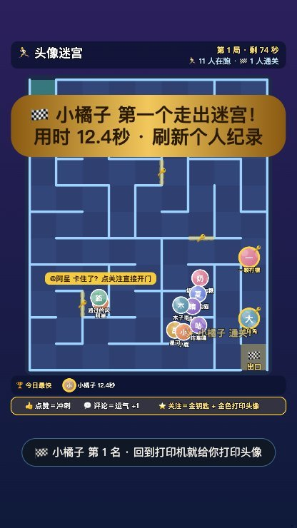
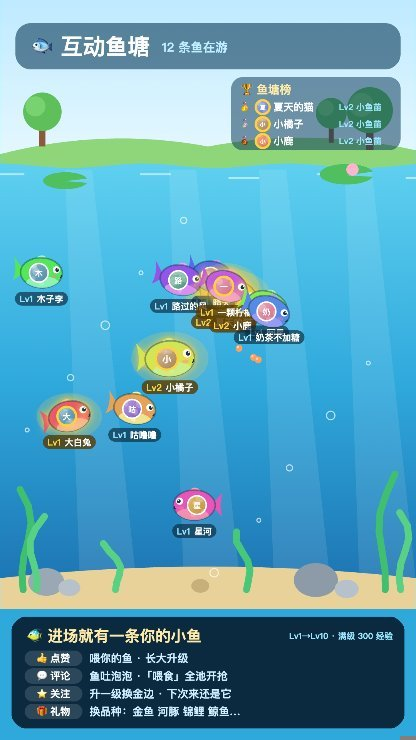
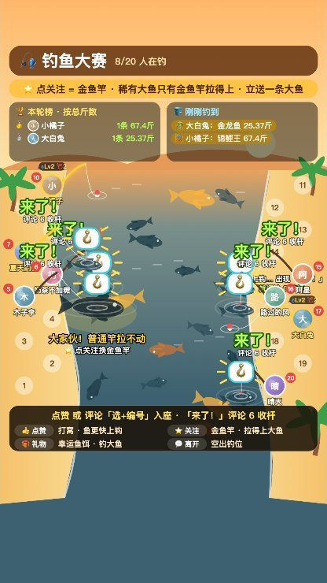

# 头像打印机 · 抖音不露脸互动直播间

<p align="center"></p>

<p align="center">
观众评论、点赞、关注，他的头像就被「3D 打印」出来；另有 4 个小游戏自动轮换，留人又涨粉。<br>
<b>🚀 <a href="#install">一键安装</a> · 🎮 <a href="#modes">五个玩法</a> · 📈 <a href="#why">为什么能涨粉</a> · 📖 <a href="docs/详细说明.md">详细说明</a></b>
</p>

> **3D打印机开源直播抖音快手tiktok直播项目** —— 志哥AI 出品。
> **开源免费声明：本软件完全开源、免费使用——可自由下载、安装、使用、修改与分享，无任何付费或授权限制。**

> 本仓库在原版基础上增加了：自然人声播报、头像迷宫 / 能量卡 / 鱼塘 / 钓鱼玩法轮换、关注引导、老粉图鉴、点赞能量条、弹幕低延迟解码等。原版：[rhfbgfgfdg999999/3d-printer-live](https://github.com/rhfbgfgfdg999999/3d-printer-live)（MIT）。

<a id="install"></a>

## 🚀 快速开始：交给 AI 一键安装

把这句话发给你的 AI 助手（Claude Code / Cursor / Codex / Trae 等能执行命令的都行）：

```text
请按照 https://github.com/hzp0906/3d-printer-live/blob/main/AI-INSTALL.md 帮我安装头像打印机直播间，装好后帮我启动。
```

自己装也只要两步：

| 系统 | 安装（只需一次） | 每次开播 |
|---|---|---|
| macOS | `bash install.sh` | 双击 `start-live.command`（填一次直播间号，之后回车即可） |
| Windows | 双击 `install.bat` | 双击 `start.bat` → 填直播间号 → 打开直播间窗口登录 → 开始抓取 |

然后在打印页点「弹出直播窗口」，用抖音直播伴侣「添加素材 → 窗口」选它开播。完整图文教程：[docs/观众教程.md](docs/观众教程.md)；给 AI 的详细步骤：[AI-INSTALL.md](AI-INSTALL.md)。

---

<a id="modes"></a>

## 🎮 五个玩法

默认按 **打印机 → 头像迷宫 → 能量卡 → 鱼塘 → 钓鱼** 自动轮换（每段 20–90 分钟可调，也可锁定一个玩法）。

| | 玩法 | 观众怎么玩 | 关注后得到 |
|---|---|---|---|
| 🖨️ | [头像打印机](#printer) | 评论 / 点赞 → 打印自己的头像；报 1–99 抽幸运卡 | 金色大头像插队打印 |
| 🏃 | [头像迷宫](#maze) | 进场自动出发，点赞冲刺，评论加运气 | 金钥匙，走金色近路门 |
| ✨ | [今日能量卡](#tarot) | 评论任意内容翻一张能量卡 | 金色能量卡插队翻 |
| 🐟 | [互动鱼塘](#pond) | 进场变成小鱼，点赞喂食长大 | 直接升级 + 金边，下次还在 |
| 🎣 | [钓鱼大赛](#fishing) | 点赞入座，「来了！」时评论 6 收杆 | 金鱼竿，才能拉上大鱼 |

<a id="printer"></a>

### 🖨️ 头像打印机


- **评论 / 点赞**：打印一张小头像；**礼物**：大头像插队。
- **评论 1–99**：抽今日幸运卡；**666 / 888 / 520** 开吉利款。
- **评论「打字 早安」**：打金色立体字；「属龙」「天蝎座」：打生肖 / 星座摆件。
- **关注**：金色「原始股东」大头像插队，上粉丝墙。点赞能量条满了，前 3 名得能量款。

<a id="maze"></a>

### 🏃 头像迷宫



- 进直播间，头像就自动出发闯迷宫，一局 90 秒。
- **点赞** = 冲刺 3 秒；**评论** = 运气 +1，岔路更容易选对。
- **关注** = 金钥匙，能穿金色近路门，同时金色大头像进打印队列。
- 每局前 3 名通关的人打印「迷宫通关款」；底部显示今日最快。
- 卡在死胡同时会提示「@名字 卡住了？点关注直接开门」。

<br clear="right">

<a id="tarot"></a>

### ✨ 今日能量卡


- 限时活动，每轮最多 10 分钟。
- 进场就有一张盖着的卡，**评论任意内容**翻开（报 1–78 翻固定那张）。
- 只给鼓励性的话，不做预测，画面常驻「仅供娱乐」。
- **关注 / 送礼** = 金色能量卡插队翻。人多时一次翻 2–3 张。

<br clear="right">

<a id="pond"></a>

### 🐟 互动鱼塘



- 进场就有一条带自己头像的小鱼游进来。
- **点赞** = 撒鱼食，鱼抢着吃长经验；**评论** = 冒泡泡，「喂食」给全池撒一把。
- **关注** = 直接升一级 + 金边，鱼会记住，下次进场还是它。
- **礼物** = 换品种（金鱼、河豚、锦鲤……鲸鱼），Lv1–Lv10。

<br clear="right">

<a id="fishing"></a>

### 🎣 钓鱼大赛



- 河两岸 20 个钓位，**点赞**或评论「选 + 编号」入座。
- 鱼上钩时头顶出现「来了！」，8 秒内评论 **6** 收杆。
- **关注** = 鱼竿升级，稀有大鱼只有金鱼竿拉得上来；礼物 = 幸运鱼饵。
- 新人进场会弹出三步「怎么玩」引导。

<br clear="right">

---

<a id="why"></a>

## 📈 为什么能涨粉

- **每个动作都有画面回报**：评论、点赞马上看到自己的头像，愿意多停留。
- **关注的回报最大最显眼**：金色大头像插队、金钥匙、金鱼竿，路人一看就知道「关注了更好玩」。
- **会按时邀请关注**：进场、打印完成、冷场时自动横幅 + 语音引导。
- **记得老粉**：老粉图鉴记录每天来访，鱼和鱼竿下次进场还在。

## 🧩 其他功能

- 🗣️ **自然人声播报**：微软神经网络语音（edge-tts），可选普通话、东北话、台湾腔等，失败时自动改用浏览器语音。
- ⚡ **低延迟弹幕**：直接解码直播间数据流，评论毫秒级触发，队列积压时自动加速。
- 🎥 **主播小窗**：可开摄像头，或用会跟着播报说话的卡通主播「小印」。
- 🏠 **5 种房间场景、自定义镜头**，画质最高 8 倍。

## ❓ 常见问题

- **安全吗？** 只读取直播间公开弹幕，不发弹幕、不送礼、不上传任何数据。
- **要花钱吗？** 完全免费开源（MIT）。
- **数据桥连不上？** 确认直播间窗口已扫码登录、直播间号填的是 `live.douyin.com/` 后面的数字。更多见 [观众教程](docs/观众教程.md#六常见问题)。

## 📚 文档

| 文档 | 内容 |
|---|---|
| [观众教程](docs/观众教程.md) | 图文安装和开播教程 |
| [AI-INSTALL.md](AI-INSTALL.md) | 给 AI 看的安装步骤 |
| [详细说明](docs/详细说明.md) | 每个功能的完整规则、参数和代码位置 |

## 🛠 开发

```bash
node --test          # 运行全部测试（需要 Node 22+）
python3 launch.py --server-only   # 启动打印页 http://127.0.0.1:8080
node douyin-bridge.mjs <直播间号>   # 启动数据桥
```

## 致谢与许可

基于 志哥AI 的开源项目 [rhfbgfgfdg999999/3d-printer-live](https://github.com/rhfbgfgfdg999999/3d-printer-live) 改进，MIT 许可，可自由使用、修改、分享。
